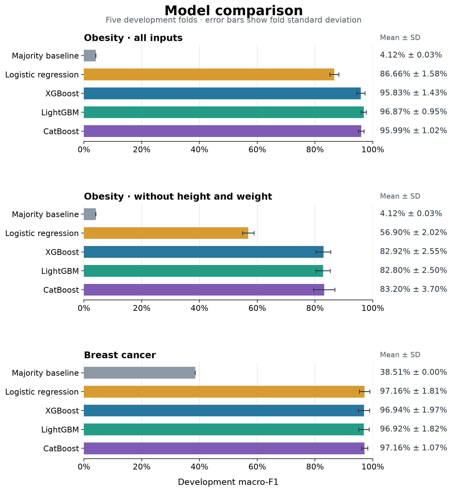
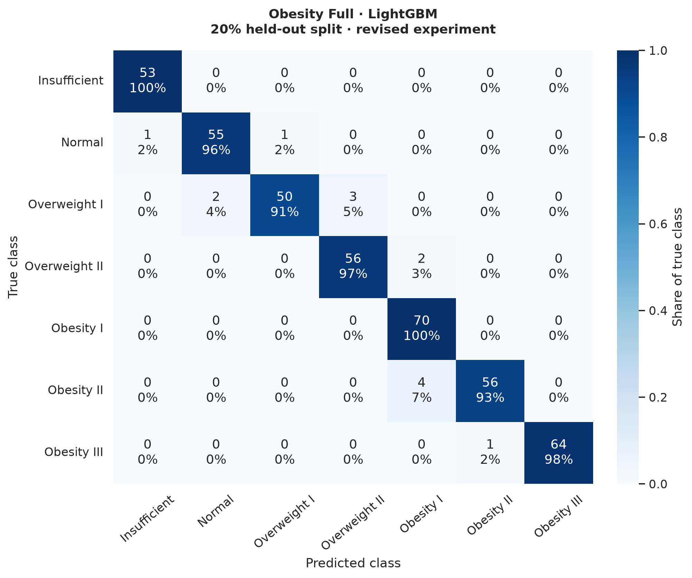

# Gradient Boosting for Tabular Classification

This started as a class project comparing XGBoost, LightGBM and CatBoost. I extended the comparison with simple baselines, a separate test split, and a closer look at the errors. I also repeated the obesity experiment without height and weight to see how much the results depend on those measurements.

The main question is straightforward: **when do boosting models improve on a simpler classifier, and what does a high score leave out?**



## What the project compares

- **Obesity levels:** seven-class classification from demographic, body-size and lifestyle inputs. There are 2,111 supplied rows; 2,087 remain after exact duplicate removal.
- **Breast cancer:** benign versus malignant classification from 30 cell-nucleus measurements, with 569 rows.
- **Models:** majority-class baseline, logistic regression, XGBoost, LightGBM and CatBoost.
- **Extra experiment:** the obesity comparison repeated without height and weight, using the same rows and splits.

The datasets come from UCI. The local files were verified against their canonical copies. Authors, licenses and processing details are in [data/README.md](data/README.md).

## How the comparison works

A stratified 20% test split is reserved at the start of the revised experiment. Five-fold stratified cross-validation runs on the remaining 80%, with the same folds for every candidate. Imputation, scaling and one-hot encoding are fitted inside each training fold. The model with the highest mean development macro-F1 is then fitted on all development rows and evaluated on the reserved split.

Macro-F1 gives every class equal weight. Accuracy and weighted-F1 are also saved. For breast cancer, the report includes malignant recall and ROC AUC. Boosting candidates use 500 iterations, a learning rate of 0.05, depth 6 and four threads. These are shared benchmark settings; the experiment does not claim to find the optimal configuration for each library.

## Results from the verified run

| Scenario | Selected model | Development macro-F1 | Test accuracy | Test macro-F1 |
| --- | --- | --- | --- | --- |
| Obesity · all inputs | LightGBM | 96.87% ± 0.95% | 96.65% | 96.64% |
| Obesity · without height/weight | CatBoost | 83.20% ± 3.70% | 85.89% | 85.56% |
| Breast cancer | Logistic regression | 97.16% ± 1.81% | 96.49% | 96.19% |

Development values are mean ± sample standard deviation across five folds. The standard deviation is not a confidence interval. Only the development-selected model in each scenario is reported on the test split.

The strongest finding is the change in the obesity results when body-size measurements are removed. Test macro-F1 falls from **96.64% to 85.56%**. The two scenarios select different models, so the matched per-model development comparison in the notebook is also useful. A high score with body measurements available does not answer the same question as classification from the remaining inputs.

For breast cancer, logistic regression and CatBoost have almost identical development macro-F1. Logistic regression has the slightly higher unrounded mean and is selected by the fixed rule. This run provides little evidence for a meaningful performance difference between them.

The cancer test set contains 114 rows. The selected classifier misses **3 of 42 malignant cases** and classifies **1 of 72 benign cases** as malignant. Its malignant recall is 92.86%; this is a more informative detail than accuracy alone.

See [the findings](reports/FINDINGS.md) for test intervals, class-level errors and interpretation.

## Figures and walkthrough



Confusion matrices show both counts and the percentage of each true class. The notebook also includes class distributions, permutation importance, ROC and precision–recall curves, measured training times, and LightGBM depth sensitivity. Every figure is generated from the experiment; PNG and SVG versions are saved in `reports/figures/`.

Open [the executed walkthrough](notebooks/benchmark_walkthrough.ipynb) for the full analysis. It reads the saved outputs, so you can inspect the results without retraining the models.

## Run it locally

The verified run used Python 3.12. Create an environment from the repository root:

```bash
python3.12 -m venv .venv
source .venv/bin/activate
python -m pip install -r requirements.txt
python -m unittest discover -s tests -v
python src/benchmark.py
```

On Windows, activate with `.venv\Scripts\activate` instead. On macOS, XGBoost and LightGBM need OpenMP. If their imports report a missing `libomp.dylib`, install it with `brew install libomp` using Homebrew, then retry.

To view the notebook locally, open it in VS Code with its Jupyter extension and select this environment. You can also install JupyterLab in the environment with `python -m pip install jupyterlab`, then run `jupyter lab`.

The full benchmark writes its output to `reports/`. An optional `--iterations` argument changes the boosting budget for experimentation; the published results use the default 500. Running a different budget replaces the saved results, so update the written interpretation before publishing those outputs.

## Project layout

```text
├── data/                      # Supplied data and attribution
├── notebooks/
│   └── benchmark_walkthrough.ipynb
├── src/
│   └── benchmark.py           # Training, evaluation and figures
├── tests/                     # Data and preprocessing boundary checks
├── reports/
│   ├── figures/               # PNG and SVG exports
│   ├── FINDINGS.md
│   ├── PROJECT_REVIEW.md
│   ├── cv_folds.csv           # Individual fold metrics
│   ├── cv_summary.csv
│   ├── test_summary.csv
│   ├── splits.json            # Indices in the cleaned data
│   └── run_metadata.json      # Settings, versions and data hashes
├── .github/workflows/checks.yml
├── .gitignore
└── requirements.txt
```

## Limits of the results

UCI reports that 77% of the obesity data is synthetic. Exact deduplication removes repeated records but cannot identify related synthetic rows. Those rows may occur on both sides of a random split. [UCI obesity dataset](https://archive.ics.uci.edu/dataset/544/estimation+of+obesity+levels+based+on+eating+habits+and+physical+condition).

The original class notebook had already evaluated these datasets. The revised test split is held out from selection in the new pipeline; it is not a new, historically unseen cohort. The cancer test sample is small, the comparison uses one split seed, and there is no external validation. These are benchmark results, not evidence that the models can be used for clinical decisions.

Permutation importance is descriptive and can understate the role of correlated features. Runtime depends on hardware and library versions. The depth analysis changes only LightGBM's maximum depth, leaving other tree settings at their defaults; it is not a full tuning study.

## Next steps

I would first repeat the development comparison across several seeds. Other useful extensions would be nested cross-validation for tuning and a comparison with CatBoost's native categorical support. These are planned experiments, not part of the reported results.

## Credits

The original work began as a class project. Dataset credit belongs to the authors listed in [the data notes](data/README.md); both datasets are distributed by UCI under CC BY 4.0. No code reuse license has been selected for this repository yet.
